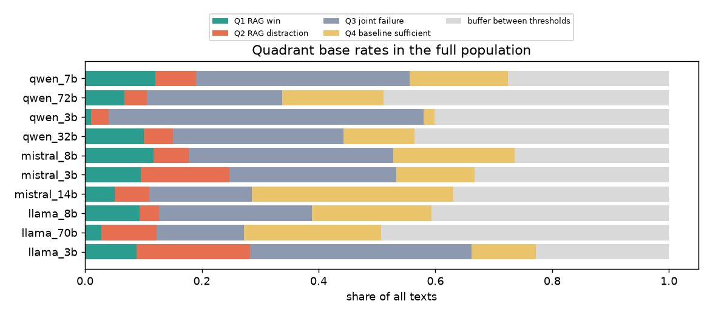
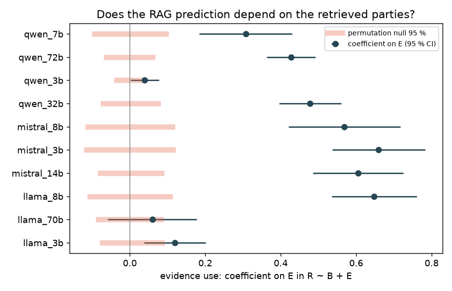
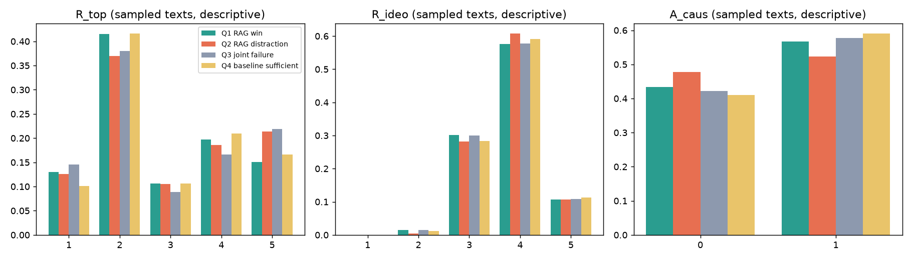

# Chunk influence on the RAG predictions

Labels: **judge**, sample tier: **all**. Quadrants: correct = |error| ≤ 0.5, wrong = |error| ≥ 1.0, texts in between = buffer (not sampled).

Party positions (CHES 2024 lrgen, 1-7 scale; = ground truth definition): DIE LINKE 1.85, BÜNDNIS 90/DIE GRÜNEN 2.83, SPD 3.08, BSW 3.17, FDP 4.63, CDU 4.95, CSU 5.54, AfD 6.56

## 1. Base rates (full population)

The sample has 25 texts per quadrant, so it over-represents rare quadrants (above all Q2). Pooled sample numbers below are weighted by these base rates; buffer texts are missing from the sample entirely.

| model | texts | Q1 share | Q2 share | Q3 share | Q4 share | buffer share |
|---|---|---|---|---|---|---|
| llama_3b | 710 | 0.09 | 0.19 | 0.38 | 0.11 | 0.23 |
| llama_70b | 775 | 0.03 | 0.09 | 0.15 | 0.23 | 0.49 |
| llama_8b | 774 | 0.09 | 0.03 | 0.26 | 0.20 | 0.41 |
| mistral_14b | 770 | 0.05 | 0.06 | 0.18 | 0.35 | 0.37 |
| mistral_3b | 761 | 0.10 | 0.15 | 0.29 | 0.13 | 0.33 |
| mistral_8b | 760 | 0.12 | 0.06 | 0.35 | 0.21 | 0.26 |
| qwen_32b | 775 | 0.10 | 0.05 | 0.29 | 0.12 | 0.44 |
| qwen_3b | 773 | 0.01 | 0.03 | 0.54 | 0.02 | 0.40 |
| qwen_72b | 775 | 0.07 | 0.04 | 0.23 | 0.17 | 0.49 |
| qwen_7b | 773 | 0.12 | 0.07 | 0.37 | 0.17 | 0.28 |
| pooled | 7646 | 0.08 | 0.08 | 0.30 | 0.17 | 0.37 |

### Party composition per quadrant (share of the quadrant's texts)

Parties close to the scale centre are 'correct' for a constant centrist prediction, so quadrant membership partly reflects the party mix:

| input_party | Q1 | Q2 | Q3 | Q4 | buffer | all texts | baseline correct (\|err\| ≤ 0.5) | position |
|---|---|---|---|---|---|---|---|---|
| DIE LINKE | 0.12 | 0.12 | 0.31 | 0.10 | 0.28 | 0.23 | 0.15 | 1.85 |
| BÜNDNIS 90/DIE GRÜNEN | 0.14 | 0.27 | 0.18 | 0.21 | 0.21 | 0.20 | 0.35 | 2.83 |
| SPD | 0.29 | 0.28 | 0.20 | 0.27 | 0.35 | 0.28 | 0.33 | 3.08 |
| FDP | 0.14 | 0.08 | 0.09 | 0.04 | 0.06 | 0.07 | 0.22 | 4.63 |
| CDU | 0.07 | 0.03 | 0.05 | 0.06 | 0.07 | 0.06 | 0.31 | 4.95 |
| CSU | 0.01 | 0.01 | 0.02 | 0.00 | 0.00 | 0.01 | 0.10 | 5.54 |
| AfD | 0.23 | 0.21 | 0.16 | 0.31 | 0.04 | 0.15 | 0.48 | 6.56 |

| constant prediction | counted correct for |
|---|---|
| 1.00 | — |
| 1.50 | DIE LINKE |
| 2.00 | DIE LINKE |
| 2.50 | BÜNDNIS 90/DIE GRÜNEN |
| 3.00 | BÜNDNIS 90/DIE GRÜNEN, SPD, BSW |
| 3.50 | SPD, BSW |
| 4.00 | — |
| 4.50 | FDP, CDU |
| 5.00 | FDP, CDU |
| 5.50 | CSU |
| 6.00 | CSU |
| 6.50 | AfD |
| 7.00 | AfD |

## 2. Evidence use (full population, not selected on outcome)

R ~ B + E (+ model / + input party), E = mean position of the retrieved chunks' parties; SE clustered by text. The permutation null shuffles E across texts within each model (1000×). `naive_pull_corr` is the earlier corr(R − B, E − B); its null mean shows how much of it appears without any evidence use.

| model | coef | ci_low | ci_high | p | perm_null_mean | perm_null_95 | perm_p | B_coef | naive_pull_corr | naive_pull_corr_null_mean | n | r2 |
|---|---|---|---|---|---|---|---|---|---|---|---|---|
| pooled | 0.43 | 0.39 | 0.48 | <0.001 | -0.00 | 0.02 | <0.001 | 0.48 | 0.57 | 0.44 | 7646 | 0.46 |
| pooled + input party | 0.32 | 0.27 | 0.37 | <0.001 | -0.00 | 0.02 | <0.001 | 0.41 | 0.57 | 0.44 | 7646 | 0.49 |
| llama_3b | 0.12 | 0.04 | 0.20 | 0.004 | 0.00 | 0.07 | 0.004 | 0.32 | 0.79 | 0.78 | 710 | 0.36 |
| llama_70b | 0.06 | -0.06 | 0.18 | 0.321 | 0.00 | 0.07 | 0.084 | 0.48 | 0.47 | 0.48 | 775 | 0.31 |
| llama_8b | 0.65 | 0.53 | 0.76 | <0.001 | 0.00 | 0.09 | <0.001 | 0.35 | 0.72 | 0.60 | 774 | 0.44 |
| mistral_14b | 0.60 | 0.49 | 0.72 | <0.001 | -0.00 | 0.08 | <0.001 | 0.75 | 0.34 | 0.09 | 770 | 0.70 |
| mistral_3b | 0.66 | 0.54 | 0.78 | <0.001 | 0.00 | 0.10 | <0.001 | 0.33 | 0.67 | 0.53 | 761 | 0.35 |
| mistral_8b | 0.57 | 0.42 | 0.72 | <0.001 | 0.00 | 0.10 | <0.001 | 0.72 | 0.30 | 0.15 | 760 | 0.58 |
| qwen_32b | 0.48 | 0.40 | 0.56 | <0.001 | -0.00 | 0.06 | <0.001 | 0.56 | 0.49 | 0.19 | 775 | 0.48 |
| qwen_3b | 0.04 | 0.00 | 0.08 | 0.040 | 0.00 | 0.03 | 0.008 | 0.15 | 0.50 | 0.47 | 773 | 0.06 |
| qwen_72b | 0.43 | 0.36 | 0.49 | <0.001 | -0.00 | 0.05 | <0.001 | 0.81 | 0.36 | 0.02 | 775 | 0.73 |
| qwen_7b | 0.31 | 0.18 | 0.43 | <0.001 | 0.00 | 0.08 | <0.001 | 0.62 | 0.30 | 0.16 | 773 | 0.24 |

Reading: holding the baseline prediction fixed, a one-point shift of the retrieved parties' mean position moves the RAG prediction by 0.43 points (95 % CI 0.39 to 0.48); the permutation null is centred at -0.00. The naive pull correlation is 0.57, of which 0.44 arises with shuffled evidence.

## 3. Which chunks carry the effect (sample, weighted, descriptive)

Same regression on the sampled texts with the positions of cited vs. uncited and relevant vs. other chunks. The sample is selected on the outcome and lacks the buffer, so read this as descriptive.

| comparison | term | coef | ci_low | ci_high | p | n_texts |
|---|---|---|---|---|---|---|
| cited vs. uncited chunks | E_cited | 0.35 | 0.26 | 0.45 | <0.001 | 638 |
| cited vs. uncited chunks | E_uncited | -0.05 | -0.15 | 0.05 | 0.355 | 638 |
| relevant (R_top ≥ 4) vs. other chunks | E_relevant | 0.26 | 0.15 | 0.37 | <0.001 | 508 |
| relevant (R_top ≥ 4) vs. other chunks | E_irrelevant | 0.01 | -0.09 | 0.12 | 0.777 | 508 |

## 4. Quadrant descriptions (sample)

Quadrants are defined by the errors, so they describe the error cases, not different mechanisms (Q1 / Q2 are selected for large moves, Q4 for none). The last columns test Q1 vs. Q2 with input party and model as controls.

| feature | Q1 | Q2 | Q3 | Q4 | all (weighted, no buffer) | Q1 vs Q2: log-odds per SD | p (party + model controlled) |
|---|---|---|---|---|---|---|---|
| mean R_top | 2.82 | 2.99 | 2.93 | 2.93 | 2.98 | -0.18 | 0.085 |
| share chunks R_top ≥ 4 | 0.35 | 0.40 | 0.39 | 0.38 | 0.40 | -0.15 | 0.138 |
| mean R_ideo | 3.78 | 3.82 | 3.78 | 3.80 | 3.82 | -0.24 | 0.047 |
| share chunks R_ideo ≥ 4 | 0.68 | 0.71 | 0.69 | 0.70 | 0.71 | -0.18 | 0.133 |
| chunks cited (of 5) | 2.83 | 2.61 | 2.89 | 2.95 | 2.84 | 0.10 | 0.397 |
| R_top of cited chunks | 2.93 | 3.15 | 3.06 | 3.05 | 3.10 | -0.24 | 0.035 |
| R_ideo of cited chunks | 3.81 | 3.83 | 3.81 | 3.86 | 3.85 | -0.16 | 0.181 |
| share chunks from input's party | 0.33 | 0.26 | 0.24 | 0.36 | 0.30 | 0.27 | 0.030 |
| share cited chunks from input's party | 0.42 | 0.31 | 0.27 | 0.46 | 0.36 | 0.31 | 0.019 |
| |cited chunks' position − ground truth| | 0.86 | 1.13 | 1.32 | 0.91 | 1.10 | -0.33 | 0.004 |

### Share of cited chunks from the input's own party, by input party (Q1 vs. Q2)

| input_party | Q1 mean | Q2 mean | Q1 count | Q2 count | position |
|---|---|---|---|---|---|
| DIE LINKE | 0.72 | 0.45 | 24 | 4 | 1.85 |
| BÜNDNIS 90/DIE GRÜNEN | 0.24 | 0.20 | 33 | 53 | 2.83 |
| SPD | 0.36 | 0.21 | 51 | 64 | 3.08 |
| FDP | 0.24 | 0.31 | 28 | 24 | 4.63 |
| CDU | 0.28 | 0.35 | 20 | 7 | 4.95 |
| CSU | 0.00 | 0.00 | 2 | 1 | 5.54 |
| AfD | 0.68 | 0.54 | 43 | 48 | 6.56 |

### Utilisation: share of chunks cited by label level

| dimension | level | n chunks | cited (weighted) | cited Q1 | cited Q2 | cited Q3 | cited Q4 |
|---|---|---|---|---|---|---|---|
| R_top | 1 | 609 | 0.45 | 0.47 | 0.40 | 0.48 | 0.38 |
| R_top | 2 | 1911 | 0.55 | 0.53 | 0.50 | 0.57 | 0.57 |
| R_top | 3 | 491 | 0.62 | 0.61 | 0.57 | 0.59 | 0.68 |
| R_top | 4 | 917 | 0.59 | 0.63 | 0.54 | 0.58 | 0.64 |
| R_top | 5 | 912 | 0.62 | 0.63 | 0.60 | 0.64 | 0.65 |
| R_ideo | 2 | 56 | 0.55 | 0.59 | 0.17 | 0.67 | 0.27 |
| R_ideo | 3 | 1411 | 0.55 | 0.58 | 0.51 | 0.58 | 0.54 |
| R_ideo | 4 | 2848 | 0.57 | 0.54 | 0.54 | 0.57 | 0.60 |
| R_ideo | 5 | 525 | 0.59 | 0.69 | 0.49 | 0.58 | 0.70 |

## 5. Noise floor

Not available: every model has one baseline run (greedy decoding, temperature 0). Re-run the no-RAG baseline once per model and pass it with `--baseline-rerun <model>=<log>`; the share of texts that land in 'Q1' / 'Q2' between two baseline runs is the part of the RAG quadrants explained by run-to-run variation (batching / FP8 non-determinism).

