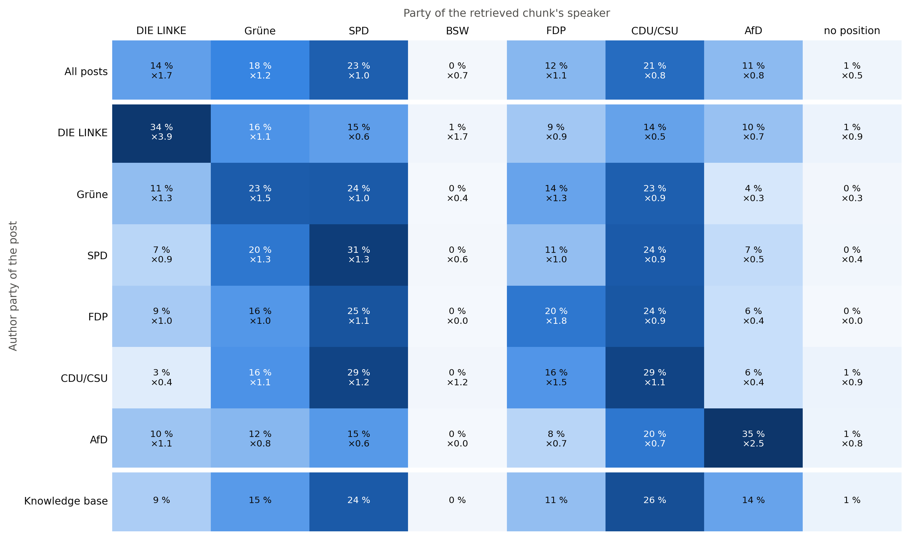

# Why retrieval helps or hurts: what e5/simple retrieves

## Data

Retrieved chunks: the e5/simple RAG logs of the ten models (k = 5). Retrieval does not depend on the generator: for all 775 texts the ten models received the identical ordered chunk list (checked), so every retrieval fact is computed once per text (775 texts, 3875 chunks). Because no model enters, the Llama-3B split by baseline score does not apply. Author parties: DIE LINKE 179, Grüne 156, SPD 217, FDP 58, CDU/CSU 51, AfD 114 posts (CDU/CSU = CDU, CSU and CDU/CSU authors; CSU authors keep the CSU position 5.54, all others the CDU value 4.95). Chunks without a position: 27 (Fraktionslos 20, fraktionslos 5, UNKNOWN 2); they count in the composition matrix as 'no position' and are left out of all shares, positions and distances. Knowledge base: `src/datasets/knowledge_base/kb_speech_counts.csv` (45499 speeches). APPROXIMATION: the knowledge-base shares are shares of speeches (thesis table tab:kb-parties), not of chunks. Retrieval draws chunks, and longer speeches yield more chunks; on the 1,731-speech development sample of the chunker the chunk share differs from the speech share by up to 2 percentage points (CDU/CSU 29.6 % vs 27.5 %, DIE LINKE 8.7 % vs 9.8 %). Expected shares and lifts are therefore approximate (lifts by up to about 10 %). Positions: CHES 2024 lrgen, two decimals; blocs left < 3.4 ≤ centre < 5.2 ≤ right. Bootstrap 2000 resamples of texts, seed 42; permutation null 1000 shuffles of the chunk lists across texts, seed 42.

## 1. Knowledge base and chance level

| Party | Speeches | Share of all speeches | Share of speeches with a position | Position (lrgen, 1-7) | Bloc |
|---|---|---|---|---|---|
| DIE LINKE | 3910 | 0.0859 | 0.0871 | 1.85 | Left |
| Grüne | 6868 | 0.1509 | 0.1529 | 2.83 | Left |
| SPD | 10806 | 0.2375 | 0.2406 | 3.08 | Left |
| BSW | 151 | 0.0033 | 0.0034 | 3.18 | Left |
| FDP | 4846 | 0.1065 | 0.1079 | 4.63 | Centre |
| CDU/CSU | 11953 | 0.2627 | 0.2661 | 4.95 | Centre |
| AfD | 6377 | 0.1402 | 0.142 | 6.56 | Right |
| no position | 588 | 0.0129 |  |  |  |

Reading: the pool is dominated by CDU/CSU (26 %) and SPD (24 %); DIE LINKE (9 %) and BSW (0.3 %) are the smallest groups. These shares of speeches define what five random chunks would contain (approximately, see Data).

| Statistic | Observed | CI low | CI high | Knowledge-base expectation | Permutation null mean | Permutation null 2.5 % | Permutation null 97.5 % | Wilcoxon p (Holm) | Permutation p |
|---|---|---|---|---|---|---|---|---|---|
| Same-party share | 0.3003 | 0.2823 | 0.3194 | 0.1647 | 0.1737 | 0.1601 | 0.1883 | <0.001 | <0.001 |
| Same-bloc share | 0.5463 | 0.5259 | 0.5661 | 0.4161 | 0.4581 | 0.4429 | 0.4721 | <0.001 | <0.001 |
| Mean position of retrieved parties | 3.828 | 3.7686 | 3.8865 | 4.0941 |  |  |  | <0.001 |  |
| Mean distance to author position | 1.2948 | 1.2392 | 1.3529 | 1.7193 | 1.6576 | 1.6125 | 1.7038 | <0.001 | <0.001 |
| Opposite-bloc share | 0.1296 | 0.1137 | 0.1461 | 0.2035 | 0.1933 | 0.1805 | 0.2061 | <0.001 | <0.001 |

Reading: for a random post, 30 % of the retrieved chunks come from the author's own party, against 16 % for random chunks and 17 % under the permutation null, which keeps the overall mix of retrieved parties but breaks the link to the post. Same-bloc (55 % vs 42 % / 46 %) and opposite-bloc chunks (13 % vs 20 % / 19 %) point the same way: retrieval is clearly party- and bloc-sensitive, but most chunks still come from other parties. The retrieved parties sit at 3.83 on average, left of the pool (4.09) and right of the posts' authors (3.50).

Cross-check with chapter 03: with the chapter-03 definitions (party positions = mean of CHES lrecon and galtan, `em.load_party_positions`) the same texts give same-party 0.3003, same-bloc 0.5468 and distance 1.2227 (`party_agreement_by_condition.csv`, e5/simple: 0.3002, 0.5467, 1.2232; there averaged over models). Same-party does not depend on positions. Same-bloc and distance differ because this chapter places parties by lrgen; this moves BSW (centre → left), CSU authors (centre → right) to another bloc.

## 2. Retrieved party composition by author party

Share of the retrieved chunks (rows sum to 1):

| Author party | DIE LINKE | Grüne | SPD | BSW | FDP | CDU/CSU | AfD | no position |
|---|---|---|---|---|---|---|---|---|
| All posts | 0.144 | 0.1781 | 0.2294 | 0.0023 | 0.1159 | 0.2111 | 0.1123 | 0.007 |
| DIE LINKE | 0.3385 | 0.1598 | 0.1464 | 0.0056 | 0.0939 | 0.1419 | 0.1028 | 0.0112 |
| Grüne | 0.1077 | 0.2333 | 0.2385 | 0.0013 | 0.141 | 0.2295 | 0.0449 | 0.0038 |
| SPD | 0.0747 | 0.1963 | 0.3124 | 0.0018 | 0.106 | 0.2359 | 0.0682 | 0.0046 |
| FDP | 0.0897 | 0.1552 | 0.2517 | 0 | 0.1966 | 0.2448 | 0.0621 | 0 |
| CDU/CSU | 0.0314 | 0.1608 | 0.2863 | 0.0039 | 0.1569 | 0.2863 | 0.0627 | 0.0118 |
| AfD | 0.0982 | 0.1158 | 0.1526 | 0 | 0.0754 | 0.1965 | 0.3509 | 0.0105 |
| Knowledge base | 0.0859 | 0.1509 | 0.2375 | 0.0033 | 0.1065 | 0.2627 | 0.1402 | 0.0129 |

Reading: the own party is the largest (or tied largest) column for DIE LINKE (34 %), SPD (31 %), CDU/CSU (29 %), AfD (35 %); Grüne posts get more chunks from SPD (24 %) than from their own party (23 %); FDP posts get more chunks from SPD (25 %) than from their own party (20 %). AfD posts still get 64 % of their chunks from other parties. The CIs per cell are in `retrieval_composition_matrix.csv`.

| Author party | Posts | Author position | Same-party share | Same-bloc share | Mean position of retrieved parties | Mean distance to author position | Opposite-bloc share |
|---|---|---|---|---|---|---|---|
| All posts | 775 |  | 0.30 (0.28-0.32) | 0.55 (0.53-0.57) | 3.83 (3.77-3.89) | 1.29 (1.24-1.35) | 0.13 (0.11-0.15) |
| DIE LINKE | 179 | 1.85 | 0.35 (0.30-0.39) | 0.66 (0.62-0.70) | 3.39 (3.25-3.53) | 1.54 (1.40-1.68) | 0.10 (0.08-0.13) |
| Grüne | 156 | 2.83 | 0.23 (0.20-0.27) | 0.58 (0.54-0.62) | 3.70 (3.59-3.80) | 1.08 (0.99-1.17) | 0.04 (0.03-0.06) |
| SPD | 217 | 3.08 | 0.31 (0.28-0.34) | 0.59 (0.55-0.62) | 3.79 (3.70-3.88) | 0.99 (0.92-1.07) | 0.07 (0.05-0.09) |
| FDP | 58 | 4.63 | 0.20 (0.14-0.26) | 0.44 (0.37-0.52) | 3.91 (3.75-4.08) | 1.12 (0.98-1.25) |  |
| CDU/CSU | 51 | 5.031 | 0.29 (0.23-0.35) | 0.41 (0.34-0.48) | 4.01 (3.86-4.15) | 1.22 (1.08-1.36) | 0.63 (0.43-0.83) |
| AfD | 114 | 6.56 | 0.35 (0.31-0.40) | 0.35 (0.31-0.40) | 4.65 (4.48-4.82) | 1.91 (1.74-2.08) | 0.37 (0.32-0.42) |

Reading: the same-party share is highest for AfD (35 %) and DIE LINKE (35 %) posts, the two parties at the ends of the scale, and lowest for FDP (20 %) and Grüne (23 %). The retrieved parties are far from the author for the parties at the ends of the scale (mean distance AfD 1.91, DIE LINKE 1.54) and close for SPD (0.99). For AfD posts 37 % of the chunks come from the left bloc. The CDU/CSU row mixes CDU authors (centre) and CSU authors (right); its opposite-bloc share rests on 7 CSU posts only. Tests against chance are in `retrieval_chance_level.csv`; for FDP, CDU/CSU the same-party excess is significant in the permutation test but not in the Holm-corrected Wilcoxon test, because most of their posts receive no own-party chunk at all (median 0), so the mean rises without the median.

## 3. Lift (observed share / knowledge-base share)

| Author party | DIE LINKE | Grüne | SPD | BSW | FDP | CDU/CSU | AfD | no position |
|---|---|---|---|---|---|---|---|---|
| All posts | 1.6757 | 1.1796 | 0.966 | 0.6998 | 1.0879 | 0.8035 | 0.8009 | 0.5392 |
| DIE LINKE | 3.9395 | 1.0585 | 0.6163 | 1.6833 | 0.8812 | 0.5401 | 0.7334 | 0.8646 |
| Grüne | 1.2532 | 1.5458 | 1.004 | 0.3863 | 1.3241 | 0.8735 | 0.3202 | 0.2976 |
| SPD | 0.8687 | 1.3005 | 1.3155 | 0.5554 | 0.9951 | 0.8981 | 0.4866 | 0.3566 |
| FDP | 1.0433 | 1.028 | 1.0599 | 0 | 1.8454 | 0.9319 | 0.4429 | 0 |
| CDU/CSU | 0.3651 | 1.0652 | 1.2054 | 1.1816 | 1.4728 | 1.0897 | 0.4477 | 0.9103 |
| AfD | 1.1432 | 0.7671 | 0.6427 | 0 | 0.7083 | 0.7479 | 2.5035 | 0.8145 |

Reading: every party is over-retrieved for its own posts (diagonal lift > 1). The strongest own-party lift is DIE LINKE (×3.9), the weakest CDU/CSU (×1.1). AfD chunks are retrieved 2.5 times as often for AfD posts as their share of the pool, but less often than that share for the posts of every other party (lift 0.3-0.7). DIE LINKE is under-retrieved for CDU/CSU posts (×0.4). The lifts of the small groups (BSW, no position) rest on few chunks and are not interpreted. With speech shares as the reference, lifts are approximate (see Data).

Figure: share of the retrieved chunks by author party (rows) and the party of the chunk's speaker (columns); the second line is the lift over the knowledge-base share. Last row: knowledge base.

## 4. Rank position

| Author party | Posts | Same-party share at rank 1 | Same-party share at rank 2 | Same-party share at rank 3 | Same-party share at rank 4 | Same-party share at rank 5 | Posts with rank 1 and 5 positioned | Rank 1 - rank 5 | CI low | CI high | Wilcoxon p (Holm) |
|---|---|---|---|---|---|---|---|---|---|---|---|
| All posts | 775 | 0.3277 | 0.3225 | 0.2905 | 0.2918 | 0.2669 | 762 | 0.063 | 0.0236 | 0.1076 | 0.032 |
| DIE LINKE | 179 | 0.3672 | 0.3693 | 0.358 | 0.3408 | 0.2768 | 175 | 0.0971 | 0.0057 | 0.1829 | 0.210 |
| Grüne | 156 | 0.2628 | 0.2179 | 0.2179 | 0.2468 | 0.2258 | 155 | 0.0387 | -0.0516 | 0.129 | 1.000 |
| SPD | 217 | 0.3767 | 0.3349 | 0.3194 | 0.2535 | 0.2857 | 215 | 0.093 | 0 | 0.1814 | 0.210 |
| FDP | 58 | 0.1552 | 0.2241 | 0.1897 | 0.2241 | 0.1897 | 58 | -0.0345 | -0.1552 | 0.0862 | 1.000 |
| CDU/CSU | 51 | 0.22 | 0.451 | 0.2353 | 0.3 | 0.24 | 49 | -0.0204 | -0.1837 | 0.1429 | 1.000 |
| AfD | 114 | 0.3982 | 0.3628 | 0.307 | 0.3805 | 0.3243 | 110 | 0.0727 | -0.0364 | 0.1818 | 0.777 |

Reading: over all posts the author's party is somewhat more frequent at rank 1 (33 %) than at rank 5 (27 %); the difference is 0.063 (95 % CI 0.024 to 0.108, Holm p 0.032). Within the author parties no difference survives the Holm correction, so the rank adds little beyond the overall party sensitivity.

## 5. Party mentions in the retrieved chunks

| Author party | Retrieved chunks | Share names any party | Share names its own party | Share names another party |
|---|---|---|---|---|
| All posts | 3875 | 0.5512 | 0.1899 | 0.4625 |
| DIE LINKE | 895 | 0.5933 | 0.2492 | 0.4838 |
| Grüne | 780 | 0.5346 | 0.1808 | 0.4449 |
| SPD | 1085 | 0.435 | 0.1088 | 0.3696 |
| FDP | 290 | 0.5517 | 0.1655 | 0.4793 |
| CDU/CSU | 255 | 0.5804 | 0.2078 | 0.4667 |
| AfD | 570 | 0.7158 | 0.2684 | 0.6193 |

Reading: 55 % of the retrieved chunks name at least one party, mostly another party than the speaker's own (46 % vs 19 %). Party names are most frequent in chunks retrieved for AfD posts (72 %).

| Author party | Chunks from other parties | ... naming the author party | Share naming the author party | Reference: same share in posts of other parties | Difference | Difference CI low | Difference CI high | Bootstrap p (Holm) |
|---|---|---|---|---|---|---|---|---|
| DIE LINKE | 592 | 86 | 0.1453 | 0.0547 | 0.0906 | 0.0599 | 0.1228 | 0.006 |
| Grüne | 598 | 82 | 0.1371 | 0.1252 | 0.0119 | -0.0223 | 0.0472 | 0.474 |
| SPD | 746 | 42 | 0.0563 | 0.1339 | -0.0776 | -0.1 | -0.0538 | 0.006 |
| FDP | 233 | 37 | 0.1588 | 0.114 | 0.0448 | -0.0108 | 0.1085 | 0.244 |
| CDU/CSU | 182 | 59 | 0.3242 | 0.1955 | 0.1287 | 0.0401 | 0.225 | 0.009 |
| AfD | 370 | 149 | 0.4027 | 0.1065 | 0.2962 | 0.2245 | 0.3735 | 0.006 |

Reading: for AfD posts, 149 of the 370 chunks from non-AfD speakers (40 %) name the AfD, against 11 % of the non-AfD chunks retrieved for other posts: a large part of the 'other-party' evidence for AfD posts is speech about the AfD rather than by it. For DIE LINKE the effect is smaller (86 of 592, 15 % vs 5 %). For SPD posts, chunks of other parties name the author's party less often than for other posts. p values: two-sided bootstrap test of the difference (texts resampled within each group), Holm-corrected across the six author parties.

Regex (case-sensitive): DIE LINKE: `\b(?:LINKEN?|Linken?)\b`; Grüne: `\b(?:GRÜNEN?|Grünen?)\b|BÜNDNIS\s90|Bündnis\s90`; SPD: `\bSPD\b`; BSW: `\bBSW\b|Bündnis\sSahra\sWagenknecht`; FDP: `\bFDP\b`; CDU/CSU: `\bCDU\b|\bCSU\b|(?<!Europäische\s)(?<!Europäischen\s)\bUnion\b|\bUnions(?:fraktion|parteien)\b`; AfD: `\bAfD\b`. Lower-case adjectives (linke, grüne) are not counted. The chunk text still contains the chair's words when the chair interrupts a speech (e.g. 'Nächster Redner ist für die Fraktion …'), so a small part of the mentions are procedural.
