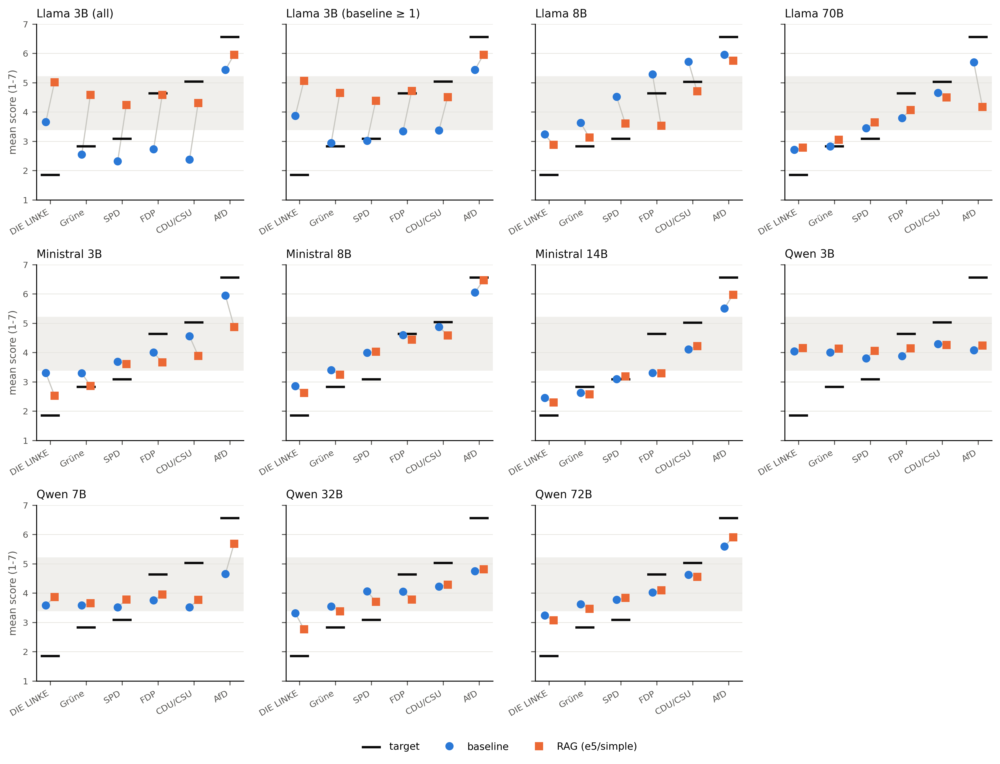
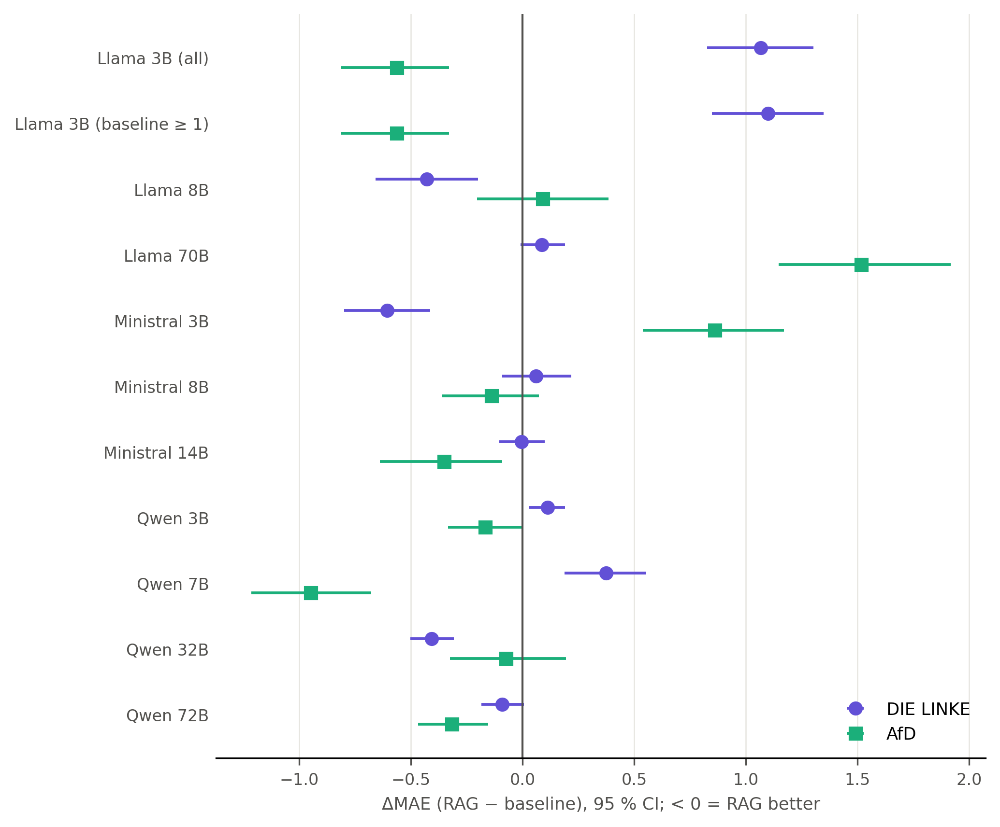

# Why retrieval helps or hurts: direction of the RAG shift

## Data

Paired posts of e5/simple (k = 5) and the no-RAG baseline per model (inner join on text_index, both scores parseable): Llama 3B 710, Llama 8B 774, Llama 70B 775, Ministral 3B 761, Ministral 8B 760, Ministral 14B 770, Qwen 3B 773, Qwen 7B 773, Qwen 32B 775, Qwen 72B 775. Llama 3B is reported on all paired posts and on the 611 posts with a baseline score ≥ 1. Target: CHES 2024 lrgen of the author's party, two decimals (DIE LINKE 1.85, Grüne 2.83, SPD 3.08, FDP 4.63, CDU 4.95, CSU 5.54, AfD 6.56); target spread AfD − DIE LINKE = 4.71. CSU posts (about 7 per model) are merged into CDU/CSU, as in the party labels of the logs, and are not tested on their own; each post keeps its own target (CSU 5.54, CDU and CDU/CSU 4.95). Centre band [3.4, 5.2). Moved = |RAG − baseline| ≥ 0.5. Paired bootstrap 2000 resamples of posts, seed 42; Wilcoxon signed-rank tests on per-post differences, Holm within each model. No other exclusions.

## 1. Overall shift per model

Baseline → RAG (difference [95 % CI]):

| Model | Mean signed error | SD of predictions | Calibration slope | Spread AfD - DIE LINKE | Share in centre band [3.4, 5.2) |
|---|---|---|---|---|---|
| Llama 3B (all) | -0.34 → 1.26 (+1.60 [+1.47, +1.73]) | 2.14 → 1.17 (-0.97 [-1.05, -0.88]) | 0.38 → 0.20 (-0.18 [-0.26, -0.10]) | 1.78 → 0.94 (-0.84 [-1.20, -0.43]) | 0.06 → 0.55 (+0.49 [+0.45, +0.53]) |
| Llama 3B (baseline ≥ 1) | 0.14 → 1.37 (+1.23 [+1.10, +1.35]) | 1.86 → 1.15 (-0.72 [-0.78, -0.64]) | 0.36 → 0.20 (-0.16 [-0.24, -0.09]) | 1.57 → 0.90 (-0.67 [-1.03, -0.28]) | 0.07 → 0.52 (+0.45 [+0.41, +0.49]) |
| Llama 8B | 0.89 → 0.23 (-0.66 [-0.78, -0.55]) | 2.01 → 1.58 (-0.44 [-0.49, -0.38]) | 0.60 → 0.58 (-0.01 [-0.09, +0.06]) | 2.72 → 2.87 (+0.15 [-0.22, +0.52]) | 0.06 → 0.25 (+0.19 [+0.15, +0.22]) |
| Llama 70B | 0.09 → -0.01 (-0.10 [-0.19, -0.00]) | 1.40 → 1.24 (-0.16 [-0.21, -0.10]) | 0.63 → 0.32 (-0.32 [-0.39, -0.24]) | 2.98 → 1.39 (-1.59 [-2.02, -1.19]) | 0.32 → 0.41 (+0.09 [+0.06, +0.12]) |
| Ministral 3B | 0.43 → -0.07 (-0.51 [-0.63, -0.39]) | 1.77 → 1.57 (-0.20 [-0.28, -0.12]) | 0.55 → 0.46 (-0.09 [-0.17, -0.01]) | 2.64 → 2.34 (-0.30 [-0.71, +0.13]) | 0.43 → 0.51 (+0.08 [+0.04, +0.12]) |
| Ministral 8B | 0.51 → 0.47 (-0.04 [-0.14, +0.06]) | 1.68 → 1.99 (+0.31 [+0.25, +0.37]) | 0.66 → 0.76 (+0.10 [+0.04, +0.17]) | 3.20 → 3.84 (+0.64 [+0.32, +0.97]) | 0.38 → 0.21 (-0.16 [-0.20, -0.13]) |
| Ministral 14B | -0.21 → -0.16 (+0.06 [-0.01, +0.13]) | 1.45 → 1.69 (+0.24 [+0.19, +0.30]) | 0.63 → 0.75 (+0.11 [+0.05, +0.18]) | 3.06 → 3.68 (+0.62 [+0.29, +0.96]) | 0.22 → 0.24 (+0.02 [-0.01, +0.05]) |
| Qwen 3B | 0.47 → 0.64 (+0.17 [+0.12, +0.22]) | 0.62 → 0.41 (-0.21 [-0.26, -0.16]) | 0.02 → 0.03 (+0.00 [-0.04, +0.04]) | 0.03 → 0.09 (+0.05 [-0.14, +0.25]) | 0.87 → 0.98 (+0.11 [+0.08, +0.13]) |
| Qwen 7B | 0.22 → 0.56 (+0.34 [+0.26, +0.43]) | 0.89 → 1.35 (+0.46 [+0.40, +0.52]) | 0.21 → 0.36 (+0.15 [+0.09, +0.21]) | 1.07 → 1.82 (+0.75 [+0.41, +1.10]) | 0.75 → 0.58 (-0.17 [-0.21, -0.14]) |
| Qwen 32B | 0.39 → 0.13 (-0.27 [-0.33, -0.20]) | 0.88 → 1.09 (+0.20 [+0.15, +0.26]) | 0.28 → 0.40 (+0.12 [+0.07, +0.18]) | 1.44 → 2.05 (+0.61 [+0.33, +0.91]) | 0.78 → 0.65 (-0.13 [-0.16, -0.09]) |
| Qwen 72B | 0.46 → 0.45 (-0.00 [-0.06, +0.05]) | 1.01 → 1.22 (+0.21 [+0.17, +0.25]) | 0.48 → 0.57 (+0.09 [+0.05, +0.12]) | 2.35 → 2.83 (+0.48 [+0.29, +0.66]) | 0.69 → 0.61 (-0.09 [-0.12, -0.06]) |

Reading: there is no common direction. With RAG, 3 of 10 models predict further right on average (Llama 3B (all), Qwen 3B, Qwen 7B) and 4 further left (Llama 8B, Llama 70B, Ministral 3B, Qwen 32B). More informative is the spread: the predictions become more dispersed (SD up) in Ministral 8B, Ministral 14B, Qwen 7B, Qwen 32B, Qwen 72B, and the AfD − DIE LINKE gap widens in Ministral 8B, Ministral 14B, Qwen 7B, Qwen 32B, Qwen 72B, towards the target gap of 4.71. The SD shrinks in Llama 3B (all), Llama 8B, Llama 70B, Ministral 3B, Qwen 3B, and the gap narrows in Llama 3B (all), Llama 70B. More predictions fall in the centre band in Llama 3B (all), Llama 8B, Llama 70B, Ministral 3B, Qwen 3B and fewer in Ministral 8B, Qwen 7B, Qwen 32B, Qwen 72B. The Llama 3B results without the sub-1 baseline scores point the same way.

## 2. Movement per post

Share of posts moved left / unchanged / right (%):

| Model | All posts | DIE LINKE | AfD |
|---|---|---|---|
| Llama 3B (all) | 9 / 25 / 66 | 13 / 27 / 60 | 14 / 59 / 27 |
| Llama 3B (baseline ≥ 1) | 11 / 29 / 60 | 14 / 29 / 58 | 14 / 59 / 27 |
| Llama 8B | 40 / 45 / 15 | 28 / 52 / 20 | 14 / 77 / 9 |
| Llama 70B | 16 / 59 / 25 | 11 / 76 / 13 | 47 / 46 / 6 |
| Ministral 3B | 43 / 35 / 22 | 53 / 27 / 20 | 51 / 35 / 13 |
| Ministral 8B | 28 / 50 / 22 | 31 / 51 / 18 | 8 / 69 / 23 |
| Ministral 14B | 21 / 56 / 23 | 25 / 61 / 14 | 11 / 57 / 32 |
| Qwen 3B | 12 / 56 / 32 | 11 / 61 / 28 | 24 / 39 / 37 |
| Qwen 7B | 18 / 46 / 36 | 21 / 41 / 38 | 8 / 24 / 68 |
| Qwen 32B | 42 / 43 / 15 | 54 / 40 / 7 | 29 / 43 / 28 |
| Qwen 72B | 25 / 48 / 27 | 36 / 46 / 18 | 7 / 49 / 44 |

Reading: RAG moves many single predictions by half a point or more: the unchanged share ranges from 25 % (Llama 3B (all)) to 59 % (Llama 70B). In most models, posts move in both directions. Where one direction dominates by at least 15 percentage points, it is: Llama 3B (all) (right), Llama 8B (left), Ministral 3B (left), Qwen 3B (right), Qwen 7B (right), Qwen 32B (left). The per-party movement is in `direction_movement.csv`.

## 3. By author party

| Model | Party | N | MAE base → RAG | dMAE [95 % CI] | p (Holm) | signed error base → RAG |
|---|---|---|---|---|---|---|
| Llama 3B (all) | DIE LINKE | 162 | 2.10 → 3.16 | +1.07 [+0.83, +1.30] | <0.001 | +1.81 → +3.16 |
| Llama 3B (all) | AfD | 107 | 1.17 → 0.60 | -0.56 [-0.81, -0.33] | <0.001 | -1.12 → -0.60 |
| Llama 3B (baseline ≥ 1) | DIE LINKE | 153 | 2.11 → 3.21 | +1.10 [+0.85, +1.35] | <0.001 | +2.02 → +3.21 |
| Llama 3B (baseline ≥ 1) | AfD | 107 | 1.17 → 0.60 | -0.56 [-0.81, -0.33] | <0.001 | -1.12 → -0.60 |
| Llama 8B | DIE LINKE | 178 | 1.56 → 1.13 | -0.43 [-0.66, -0.20] | <0.001 | +1.38 → +1.04 |
| Llama 8B | AfD | 114 | 0.72 → 0.81 | +0.09 [-0.20, +0.38] | 0.512 | -0.61 → -0.81 |
| Llama 70B | DIE LINKE | 179 | 0.88 → 0.97 | +0.09 [-0.01, +0.19] | 0.060 | +0.86 → +0.93 |
| Llama 70B | AfD | 114 | 0.87 → 2.39 | +1.52 [+1.15, +1.92] | <0.001 | -0.87 → -2.38 |
| Ministral 3B | DIE LINKE | 179 | 1.66 → 1.05 | -0.61 [-0.80, -0.41] | <0.001 | +1.45 → +0.68 |
| Ministral 3B | AfD | 113 | 0.99 → 1.85 | +0.86 [+0.54, +1.17] | <0.001 | -0.62 → -1.68 |
| Ministral 8B | DIE LINKE | 178 | 1.36 → 1.42 | +0.06 [-0.09, +0.22] | 0.458 | +1.00 → +0.78 |
| Ministral 8B | AfD | 113 | 0.89 → 0.75 | -0.14 [-0.36, +0.07] | 0.654 | -0.51 → -0.09 |
| Ministral 14B | DIE LINKE | 177 | 0.75 → 0.74 | -0.00 [-0.10, +0.10] | 0.655 | +0.60 → +0.45 |
| Ministral 14B | AfD | 114 | 1.24 → 0.89 | -0.35 [-0.64, -0.09] | 0.068 | -1.06 → -0.59 |
| Qwen 3B | DIE LINKE | 179 | 2.19 → 2.30 | +0.11 [+0.03, +0.19] | 0.160 | +2.19 → +2.30 |
| Qwen 3B | AfD | 114 | 2.49 → 2.32 | -0.17 [-0.33, +0.00] | 0.255 | -2.49 → -2.32 |
| Qwen 7B | DIE LINKE | 178 | 1.74 → 2.11 | +0.37 [+0.19, +0.55] | <0.001 | +1.73 → +2.02 |
| Qwen 7B | AfD | 114 | 1.91 → 0.96 | -0.95 [-1.21, -0.68] | <0.001 | -1.91 → -0.87 |
| Qwen 32B | DIE LINKE | 179 | 1.46 → 1.05 | -0.41 [-0.50, -0.31] | <0.001 | +1.46 → +0.92 |
| Qwen 32B | AfD | 114 | 1.82 → 1.74 | -0.07 [-0.32, +0.19] | 1.000 | -1.81 → -1.74 |
| Qwen 72B | DIE LINKE | 179 | 1.38 → 1.29 | -0.09 [-0.18, +0.01] | 0.345 | +1.38 → +1.22 |
| Qwen 72B | AfD | 114 | 0.98 → 0.66 | -0.31 [-0.47, -0.15] | <0.001 | -0.97 → -0.66 |

Reading: for DIE LINKE posts RAG lowers the error in Llama 8B, Ministral 3B, Qwen 32B and raises it in Llama 3B (all), Qwen 3B, Qwen 7B; for AfD posts it lowers the error in Llama 3B (all), Ministral 14B, Qwen 7B, Qwen 72B and raises it in Llama 70B, Ministral 3B (95 % CIs of ΔMAE). The extremes therefore do not move together: a model can improve one end and worsen the other. The largest single deterioration is Llama 70B for AfD posts (MAE 0.87 → 2.39). CIs and Holm-corrected p values are computed per model; all parties incl. Grüne, SPD, FDP and CDU/CSU are in `direction_by_party.csv` (no cell has fewer than 30 posts after merging CSU into CDU/CSU).

Preliminary figure check (Llama 70B, AfD posts): the unpaired, all-conditions file `results/evaluation/2026-11-12_full/bias_by_party_label_ideology.csv` gives a mean signed error of -0.91 without RAG and -2.42 for e5/simple (range over its 15 RAG conditions -2.60 to -2.14), against the one-decimal target 6.6. On the 114 paired posts here the same target gives -0.91 → -2.42, i.e. the same numbers. With the two-decimal target (6.56) used in this chapter the values are -0.87 → -2.38: e5/simple shows the same large leftward shift for AfD posts.

## 4. Compression or shift?

Rule (d = RAG − baseline signed error, 95 % CI): 'compresses' if d > 0 for DIE LINKE and d < 0 for AfD (both CIs exclude 0: both ends pulled towards the centre); 'expands' if d < 0 for DIE LINKE and d > 0 for AfD; 'shifts right' if both CIs lie above 0, or one lies above 0 and the other includes 0 with a positive point estimate; 'shifts left' mirrored; 'mixed' for everything else (both CIs include 0, or one end moves significantly and the other non-significantly in the opposite direction).

| Model | DIE LINKE d [95 % CI] | AfD d [95 % CI] | Classification | Detail |
|---|---|---|---|---|
| Llama 3B (all) | +1.36 [+1.09, +1.62] | +0.52 [+0.28, +0.78] | shifts right |  |
| Llama 3B (baseline ≥ 1) | +1.19 [+0.93, +1.45] | +0.52 [+0.28, +0.78] | shifts right |  |
| Llama 8B | -0.35 [-0.58, -0.11] | -0.20 [-0.49, +0.10] | shifts left |  |
| Llama 70B | +0.08 [-0.02, +0.18] | -1.52 [-1.92, -1.14] | mixed | only AfD moves significantly (left, towards the centre) |
| Ministral 3B | -0.77 [-1.00, -0.55] | -1.07 [-1.42, -0.70] | shifts left |  |
| Ministral 8B | -0.22 [-0.41, -0.03] | +0.42 [+0.17, +0.67] | expands |  |
| Ministral 14B | -0.15 [-0.26, -0.05] | +0.47 [+0.18, +0.79] | expands |  |
| Qwen 3B | +0.11 [+0.03, +0.19] | +0.17 [-0.00, +0.33] | shifts right |  |
| Qwen 7B | +0.29 [+0.08, +0.49] | +1.03 [+0.76, +1.29] | shifts right |  |
| Qwen 32B | -0.54 [-0.65, -0.43] | +0.07 [-0.20, +0.32] | mixed | only DIE LINKE moves significantly (left, outwards) |
| Qwen 72B | -0.16 [-0.27, -0.06] | +0.31 [+0.15, +0.47] | expands |  |

Reading: no model compresses both ends towards the centre. expands: Ministral 8B, Ministral 14B, Qwen 72B; shifts left: Llama 8B, Ministral 3B; shifts right: Llama 3B (all), Qwen 3B, Qwen 7B; mixed: Llama 70B, Qwen 32B. 'Expands' means RAG moves DIE LINKE posts further left and AfD posts further right, i.e. it reduces the compression the baselines already have (every baseline places DIE LINKE posts too far right and AfD posts too far left). The 2 'mixed' case(s) are described in the detail column. Classification counts: shifts right 3, expands 3, shifts left 2, mixed 2.

## 5. Pooled mixed models

`abs_error ~ rag * C(party, Treatment('SPD')) + C(model) + (1 | text_index)` (and the same for signed error), ML fit, random intercept per text, 15292 rows / 775 texts; all fits converged: True. Llama 3B on all paired posts (the version with baseline ≥ 1 is in `direction_lmm.csv`).

| Outcome | Term | Coefficient [95 % CI] | p | p (Holm, interactions) |
|---|---|---|---|---|
| abs error | rag (effect for SPD) | -0.022 [-0.076, +0.032] | 0.423 |  |
| abs error | rag x AfD | +0.016 [-0.076, +0.108] | 0.733 | 1.000 |
| abs error | rag x CDU/CSU | -0.190 [-0.314, -0.065] | 0.003 | 0.014 |
| abs error | rag x DIE LINKE | +0.029 [-0.052, +0.109] | 0.484 | 1.000 |
| abs error | rag x FDP | -0.126 [-0.244, -0.009] | 0.035 | 0.141 |
| abs error | rag x Grüne | +0.026 [-0.058, +0.109] | 0.547 | 1.000 |
| signed error | rag (effect for SPD) | +0.134 [+0.066, +0.203] | <0.001 |  |
| signed error | rag x AfD | -0.116 [-0.232, +0.000] | 0.051 | 0.203 |
| signed error | rag x CDU/CSU | -0.128 [-0.285, +0.029] | 0.111 | 0.255 |
| signed error | rag x DIE LINKE | -0.184 [-0.286, -0.082] | <0.001 | 0.002 |
| signed error | rag x FDP | -0.131 [-0.279, +0.018] | 0.085 | 0.255 |
| signed error | rag x Grüne | -0.044 [-0.150, +0.062] | 0.414 | 0.414 |

Reading: pooled over models, RAG moves SPD posts +0.13 points (signed error) and leaves their absolute error unchanged (95 % CI includes 0). After Holm correction the RAG effect differs from SPD for CDU/CSU (abs error), DIE LINKE (signed error). The pooled model assumes one RAG effect for all models. Sections 1-4 show that the models move in opposite directions, so these pooled interactions average over opposite effects and understate the party-specific changes within single models.

Figure: mean prediction per author party, baseline (circle) and RAG (square); black bar = mean target; grey band = centre band [3.4, 5.2).

Figure: ΔMAE (RAG − baseline) for DIE LINKE and AfD posts per model with 95 % CI.
