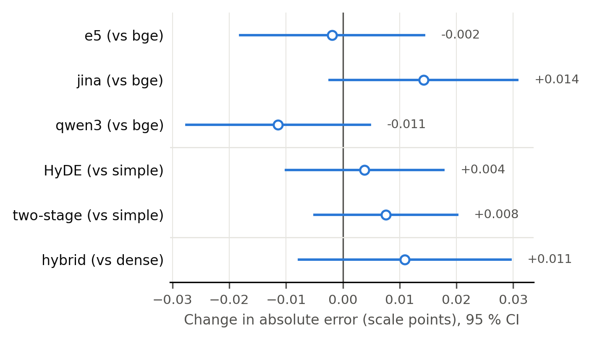

# Why retrieval helps or hurts: explanatory models with crossed random effects

## Data

Main evaluation matrix as in chapters 02/03 (`retrieval_config_analysis.main_matrix`: party_label logs, k = 5, bge/hyde_hybrid excluded, duplicates resolved to the latest run, so the re-run Ministral-8B bge/twostage and bge/twostage_hybrid cells of 2026-11-10 replace the superseded 2026-08-08 runs). 113661 rows (105913 RAG, 7748 no-RAG), 775 texts, 10 models, 15 conditions; rows per model 10689-11625 (Qwen 72B has one condition fewer; rows with unparseable scores are dropped). Outcome: absolute error against the CHES 2024 lrgen of the author's party, two decimals (the stored estimates used label_ideology with one decimal resp. the exact lrgen). Size = log2 of the parameter count, centred, so its coefficient is per doubling. Llama 3B: all posts and, in the CSV, without the texts whose Llama-3B baseline score is < 1 (all conditions of these texts for Llama 3B).

Methods compared:

* **old spec**: the specification of `evaluate_metrics.compute_factor_analysis` (random intercept per text, ML), refitted on the current data;
* **crossed**: REML with crossed variance components for text and model; M1 and M2 add a random RAG slope per model, because size × RAG and family × RAG are also between-model comparisons (statsmodels `MixedLM`, one group, `vc_formula`);
* **two-stage**: stage 1 estimates one level (and one RAG effect) per model with a random intercept per text; stage 2 regresses the 10 model effects on size and family (M2: size and time) by OLS with t-based CIs (6 resp. 7 df). This is the small-sample check for the model-level terms;
* **stored**: the estimates in `results/evaluation/2026-11-12_full/factor_analysis_label_ideology.csv` and `03_retrieval_configs/m3_coefficients.csv`.

## M1_family_size

| Term | stored (11-12_full) | old spec, current data | crossed | two-stage |
|---|---|---|---|---|
| size (per doubling) | -0.155 [-0.168, -0.143] | -0.155 [-0.167, -0.142] | -0.155 [-0.210, -0.100] | -0.155 [-0.225, -0.085] |
| Ministral (vs Llama) | -0.405 [-0.458, -0.352] | -0.400 [-0.453, -0.347] | -0.400 [-0.634, -0.166] | -0.400 [-0.698, -0.102] |
| Qwen (vs Llama) | -0.153 [-0.202, -0.105] | -0.152 [-0.201, -0.104] | -0.152 [-0.368, +0.063] | -0.152 [-0.427, +0.122] |
| RAG | -0.116 [-0.154, -0.078] | -0.113 [-0.151, -0.075] | -0.108 [-0.370, +0.153] | -0.109 [-0.442, +0.225] |
| size (per doubling) × RAG | +0.036 [+0.023, +0.048] | +0.035 [+0.022, +0.048] | +0.034 [-0.055, +0.122] | +0.034 [-0.079, +0.146] |
| Ministral (vs Llama) × RAG | +0.178 [+0.124, +0.232] | +0.168 [+0.114, +0.223] | +0.163 [-0.213, +0.538] | +0.163 [-0.316, +0.641] |
| Qwen (vs Llama) × RAG | +0.100 [+0.050, +0.150] | +0.096 [+0.045, +0.146] | +0.092 [-0.255, +0.439] | +0.092 [-0.350, +0.534] |
| AfD (vs SPD) | +0.373 [+0.271, +0.475] | +0.327 [+0.225, +0.429] | +0.327 [+0.224, +0.429] |  |
| CDU/CSU (vs SPD) | +0.114 [-0.024, +0.251] | +0.130 [-0.007, +0.268] | +0.131 [-0.007, +0.269] |  |
| DIE LINKE (vs SPD) | +0.490 [+0.401, +0.579] | +0.506 [+0.417, +0.595] | +0.506 [+0.417, +0.596] |  |
| FDP (vs SPD) | +0.065 [-0.065, +0.196] | +0.072 [-0.058, +0.203] | +0.072 [-0.059, +0.203] |  |
| Grüne (vs SPD) | +0.074 [-0.018, +0.167] | +0.056 [-0.037, +0.148] | +0.056 [-0.037, +0.149] |  |

Reading: the point estimates hardly change (the design is nearly balanced), but the CIs of the model-level terms become 4-7 times wider once model is a random effect. Still clearly different from 0: size (per doubling) -0.155 [-0.210, -0.100], Ministral (vs Llama) -0.400 [-0.634, -0.166]. No longer significant: Qwen (vs Llama), RAG, size (per doubling) × RAG, Ministral (vs Llama) × RAG, Qwen (vs Llama) × RAG. The two-stage check (10 model effects, t-based CIs) agrees on every term. Without the Llama-3B posts with a baseline score < 1 no term changes its significance. The average RAG effect for Llama (the reference family) at mean size is -0.108 [-0.370, +0.153] on all posts and -0.002 [-0.301, +0.298] without the sub-1 Llama-3B scores: the negative RAG coefficient comes largely from those scores. The party terms are within-text contrasts and do not change.

## M2_time_size

| Term | stored (11-12_full) | old spec, current data | crossed | two-stage |
|---|---|---|---|---|
| size (per doubling) | -0.161 [-0.173, -0.149] | -0.160 [-0.173, -0.148] | -0.160 [-0.218, -0.103] | -0.160 [-0.232, -0.089] |
| time (per year) | -0.250 [-0.285, -0.215] | -0.246 [-0.281, -0.211] | -0.246 [-0.408, -0.085] | -0.246 [-0.447, -0.046] |
| RAG | -0.023 [-0.043, -0.002] | -0.025 [-0.045, -0.004] | -0.023 [-0.157, +0.112] | -0.023 [-0.188, +0.142] |
| size (per doubling) × RAG | +0.040 [+0.027, +0.053] | +0.039 [+0.026, +0.052] | +0.037 [-0.046, +0.120] | +0.037 [-0.065, +0.140] |
| time (per year) × RAG | +0.105 [+0.069, +0.141] | +0.099 [+0.063, +0.135] | +0.096 [-0.139, +0.330] | +0.096 [-0.193, +0.384] |
| AfD (vs SPD) | +0.373 [+0.271, +0.475] | +0.327 [+0.225, +0.429] | +0.327 [+0.224, +0.429] |  |
| CDU/CSU (vs SPD) | +0.114 [-0.024, +0.251] | +0.130 [-0.007, +0.268] | +0.131 [-0.007, +0.269] |  |
| DIE LINKE (vs SPD) | +0.490 [+0.401, +0.579] | +0.506 [+0.417, +0.595] | +0.506 [+0.417, +0.596] |  |
| FDP (vs SPD) | +0.065 [-0.065, +0.196] | +0.072 [-0.058, +0.203] | +0.072 [-0.059, +0.203] |  |
| Grüne (vs SPD) | +0.074 [-0.019, +0.167] | +0.056 [-0.037, +0.148] | +0.056 [-0.037, +0.149] |  |

Reading: the point estimates hardly change (the design is nearly balanced), but the CIs of the model-level terms become 5-6 times wider once model is a random effect. Still clearly different from 0: size (per doubling) -0.160 [-0.218, -0.103], time (per year) -0.246 [-0.408, -0.085]. No longer significant: RAG, size (per doubling) × RAG, time (per year) × RAG. The two-stage check (10 model effects, t-based CIs) agrees on every term. Without the Llama-3B posts with a baseline score < 1 no term changes its significance. With 10 models, time and family are partly confounded (the Ministral-3 models are the newest), so the time coefficient should not be read separately from the family effect of M1.

## M3_rag_design

| Term | stored (11-12_full) | stored (ch. 03) | old spec, current data | crossed | two-stage |
|---|---|---|---|---|---|
| size (per doubling) | -0.120 [-0.123, -0.116] | -0.120 [-0.123, -0.116] | -0.120 [-0.123, -0.117] | -0.121 [-0.189, -0.053] | -0.121 [-0.204, -0.038] |
| Ministral (vs Llama) | -0.227 [-0.241, -0.213] | -0.231 [-0.245, -0.217] | -0.232 [-0.246, -0.218] | -0.237 [-0.525, +0.050] | -0.237 [-0.591, +0.116] |
| Qwen (vs Llama) | -0.053 [-0.066, -0.040] | -0.058 [-0.071, -0.044] | -0.057 [-0.070, -0.043] | -0.060 [-0.326, +0.205] | -0.061 [-0.387, +0.265] |
| AfD (vs SPD) | +0.378 [+0.276, +0.481] | +0.333 [+0.230, +0.436] | +0.332 [+0.229, +0.435] | +0.332 [+0.229, +0.436] |  |
| CDU/CSU (vs SPD) | +0.105 [-0.034, +0.243] | +0.123 [-0.016, +0.261] | +0.121 [-0.017, +0.260] | +0.122 [-0.018, +0.261] |  |
| DIE LINKE (vs SPD) | +0.494 [+0.404, +0.584] | +0.510 [+0.420, +0.600] | +0.509 [+0.419, +0.600] | +0.510 [+0.419, +0.600] |  |
| FDP (vs SPD) | +0.059 [-0.073, +0.190] | +0.070 [-0.062, +0.201] | +0.065 [-0.067, +0.197] | +0.065 [-0.067, +0.198] |  |
| Grüne (vs SPD) | +0.078 [-0.015, +0.172] | +0.061 [-0.032, +0.155] | +0.060 [-0.034, +0.153] | +0.060 [-0.034, +0.154] |  |
| HyDE (vs simple) | +0.002 [-0.011, +0.015] | +0.003 [-0.011, +0.017] | +0.003 [-0.011, +0.017] | +0.004 [-0.010, +0.018] |  |
| e5 (vs bge) | -0.003 [-0.019, +0.013] | -0.003 [-0.019, +0.014] | -0.003 [-0.019, +0.014] | -0.002 [-0.018, +0.014] |  |
| hybrid (vs dense) | +0.008 [-0.008, +0.024] | +0.010 [-0.009, +0.029] | +0.010 [-0.009, +0.029] | +0.011 [-0.008, +0.029] |  |
| jina (vs bge) | +0.013 [-0.004, +0.029] | +0.013 [-0.003, +0.030] | +0.013 [-0.003, +0.030] | +0.014 [-0.002, +0.031] |  |
| qwen3 (vs bge) | -0.012 [-0.028, +0.005] | -0.012 [-0.028, +0.005] | -0.012 [-0.028, +0.005] | -0.011 [-0.028, +0.005] |  |
| two-stage (vs simple) | +0.009 [-0.004, +0.021] | +0.009 [-0.004, +0.021] | +0.009 [-0.004, +0.021] | +0.008 [-0.005, +0.020] |  |

Reading: the point estimates hardly change (the design is nearly balanced), but the CIs of the model-level terms become about 20 times wider once model is a random effect. Still clearly different from 0: size (per doubling) -0.121 [-0.189, -0.053]. No longer significant: Ministral (vs Llama), Qwen (vs Llama). The two-stage check (10 model effects, t-based CIs) agrees on every term. Without the Llama-3B posts with a baseline score < 1 no term changes its significance. The design factors vary within each model, so their estimates and CIs are practically the same in all methods; none is significant for the absolute error.

## Variance components (crossed fits)

| Model | Method | N rows | N texts | N models | Var model | Var model_rag | Var text | Var residual | Converged |
|---|---|---|---|---|---|---|---|---|---|
| M1_family_size | crossed: text + model + model × RAG | 113661 | 775 | 10 | 0.0196 | 0.0522 | 0.1991 | 0.7913 | True |
| M2_time_size | crossed: text + model + model × RAG | 113661 | 775 | 10 | 0.0213 | 0.0459 | 0.1991 | 0.7913 | True |
| M3_rag_design | crossed: text + model | 105913 | 775 | 10 | 0.0312 |  | 0.2028 | 0.7862 | True |

Reading: in M1 the model intercept variance is 0.020 and the variance of the model-specific RAG effect 0.052, against 0.199 for texts and 0.791 residual. The between-model variation of the RAG effect (SD 0.23) is larger than the average RAG effect, which is why size × RAG and family × RAG cannot be distinguished from 0 with 10 models.

## Design factors (M3, crossed)

Figure: design-factor coefficients of M3 (crossed random effects for text and model), absolute error, 95 % CI; filled = p < 0.05. Replaces the chapter-03 figure, which also showed size and family.

Reading: all design-factor effects lie between -0.011 and +0.014 scale points, with CIs that include 0 (0 of 6 exclude it). Embedding model, retrieval strategy and hybrid search do not change the absolute error beyond ±0.03 points, an order of magnitude less than one doubling of model size.
