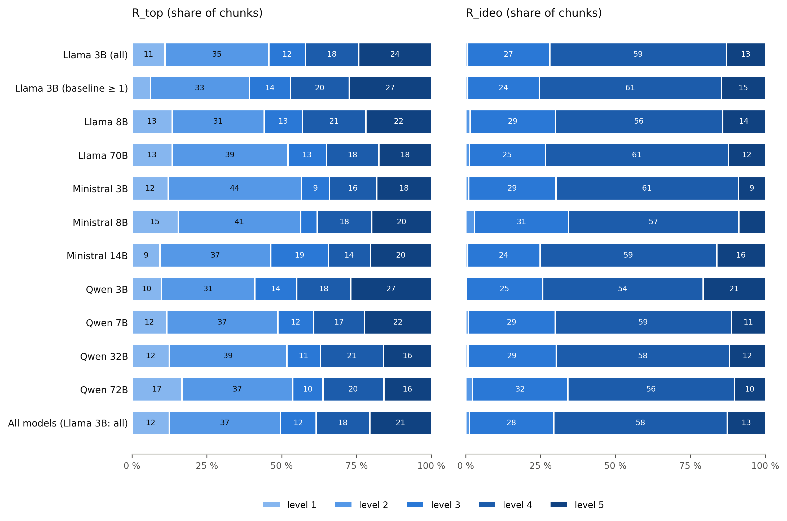

# Why retrieval helps or hurts: the LLM judge

## Data

Human annotation: 25 texts × 5 chunks = 125 chunks, rated by 3 annotators (Awsam, Jannes, Neda) on R_top (1-5), R_ideo (1-5) and A_caus (0/1). The texts come from the quadrant sample of meta-llama/Llama-3.1-8B-Instruct with e5/simple retrieval (Q1 6, Q2 6, Q3 4, Q4 9 texts). Judge: TypeSafe Jev 1.14, question set v1, run 2026-10-23_142551 with the R_ideo cut points. Final labels: `final_annotations.jsonl` of the ten models, 4840 chunks of 968 (model, text) pairs (Llama 3B 100, Llama 8B 100, Llama 70B 97, Ministral 3B 100, Ministral 8B 100, Ministral 14B 100, Qwen 3B 71, Qwen 7B 100, Qwen 32B 100, Qwen 72B 100 texts). The quadrants are the ones the texts were sampled in (one-decimal target of the logs). The weights for the population use the paired posts of the e5/simple vs. no-RAG logs; they cover Q1-Q4 only, because the buffer texts (error between 0.5 and 1.0) were not sampled. Llama 3B is reported on all sampled texts and on the texts with a baseline score ≥ 1. Bootstrap: 2000 resamples of texts, seed 42. No exclusions apart from these.

## 1. Human agreement

| Dimension | alpha first round | alpha after revision | pairwise kappa after revision (min-max) | kappa type |
|---|---|---|---|---|
| R_top | 0.33 (0.17 to 0.46) | 0.82 (0.75 to 0.86) | 0.77-0.91 | QWK |
| R_ideo | 0.31 (0.19 to 0.42) | 0.63 (0.50 to 0.73) | 0.58-0.70 | QWK |
| A_caus | 0.68 (0.53 to 0.82) | 0.88 (0.79 to 0.96) | 0.87-0.89 | Cohen's kappa |

Reading: rated independently with only the help page, the annotators agreed poorly on the two ordinal scales (R_top α 0.33). After they discussed 94 of the 125 chunks and revised their own ratings (Awsam 79, Jannes 85, Neda 40 values changed), agreement reached α 0.82 for R_top and 0.63 for R_ideo. R_ideo stays the weakest dimension, and its CI is wide because almost all chunks are rated 3 or 4. The CIs resample the 25 texts.

Consensus (`revised/consensus_reference_annotations.jsonl`): per chunk, the median of the three revised ratings for R_top and R_ideo and the majority for A_caus (`consensus_label` in `compare_human_annotations.py`; ties rounded up, which cannot occur with three raters). Re-deriving all 375 consensus labels with this rule gives 0 mismatches. After revision the three annotators agree completely on 45 (R_top), 58 (R_ideo) and 114 (A_caus) chunks, and on all three dimensions for 17. The chunks discussed are listed in `revised/Annotations - annotation_disagreements.csv`.

Note on a later correction: the numbers above are the archived state on which the judge was calibrated and the final labels were built (revised report of 22 Oct; CIs computed on the disagreement CSV as of `e58fb1c^`, which reproduces that report exactly). Commit e58fb1c (29 Oct) later corrected three chunks in the CSV. With the corrected CSV, α is 0.823 (R_top), 0.631 (R_ideo) and 0.882 (A_caus), and 2 consensus labels would change: text 73, chunk 0, R_ideo 4 → 5 (final label from the consensus in Llama 8B, Ministral 8B, Qwen 7B); text 382, chunk 3, A_caus 0 → 1 (no final label uses it). One of the three corrections (text 39, chunk 2, A_caus = 1) was already in the consensus file. The judge-vs-consensus figures and the final labels use the consensus file as it is.

## 2. Judge vs. humans (125 calibration chunks)

| Dimension | human vs human QWK | judge vs human QWK | ratio (95 % CI) | judge vs consensus QWK / kappa¹ (95 % CI) | exact agreement with consensus |
|---|---|---|---|---|---|
| R_top | 0.82 | 0.65 | 0.79 (0.61 to 0.90) | 0.68 (0.52 to 0.79) | 0.48 |
| R_ideo | 0.65 | 0.57 | 0.88 (0.75 to 1.02) | 0.61 (0.46 to 0.72) | 0.66 |
| A_caus | 0.88 | 0.73 | 0.82 (0.61 to 1.00) | 0.74 (0.54 to 0.92) | 0.87 |

¹ QWK for R_top and R_ideo, Cohen's kappa for A_caus (for 0/1 labels the two coincide).

Reading: the judge reaches 79 % (R_top), 88 % (R_ideo) and 82 % (A_caus) of the agreement two humans reach with each other. The ratios and the human/judge QWKs come from `range_restriction_2026-10-23_142551_ideo_cuts.json` (in `LLM calib/range_restriction_runs/archive/`). The judge-vs-consensus coefficients are recomputed from the run's per-chunk labels, match that file, and get text-clustered CIs here. For R_ideo the cut points were fitted on these same 125 chunks, so its row is in-sample; the out-of-sample effect is in the next table.

| Dimension | labels | LOTO alpha | LOTO QWK | LOTO exact | LOTO bias |
|---|---|---|---|---|---|
| R_top | gate ladder (0.5 thresholds) | 0.69 | 0.68 | 0.48 | +0.024 |
| R_top | distribution-matched cut points | 0.69 | 0.68 | 0.46 | +0.000 |
| R_ideo | gate ladder (0.5 thresholds) | 0.56 | 0.58 | 0.64 | +0.088 |
| R_ideo | distribution-matched cut points | 0.58 | 0.60 | 0.63 | -0.008 |

Reading: in leave-one-text-out cross-validation (cut points fitted on 24 texts, applied to the 25th; `posthoc_quantile_2026-10-23_142551.json`) the cut points raise R_ideo α from 0.56 to 0.58 and remove its upward bias. On the 8-text holdout (fit on the 17 development texts; `CALIBRATION_LOG.md`, round 3b) R_ideo α rises from 0.608 to 0.665. For R_top the cut points do not help (α 0.69 → 0.69), so R_top is read off the gate ladder.

| Dimension | Rater | Share level 1 | Share level 2 | Share level 3 | Share level 4 | Share level 5 |
|---|---|---|---|---|---|---|
| R_top | Awsam | 0.08 | 0.272 | 0.2 | 0.176 | 0.272 |
| R_top | Jannes | 0.096 | 0.288 | 0.168 | 0.248 | 0.2 |
| R_top | Neda | 0.16 | 0.272 | 0.2 | 0.216 | 0.152 |
| R_top | Consensus | 0.08 | 0.296 | 0.184 | 0.232 | 0.208 |
| R_top | Judge (run 2026-10-23_142551, R_ideo cut points) | 0.064 | 0.368 | 0.112 | 0.2 | 0.256 |
| R_ideo | Awsam | 0 | 0.032 | 0.344 | 0.408 | 0.216 |
| R_ideo | Jannes | 0 | 0.024 | 0.208 | 0.568 | 0.2 |
| R_ideo | Neda | 0 | 0.008 | 0.192 | 0.608 | 0.192 |
| R_ideo | Consensus | 0 | 0.016 | 0.224 | 0.568 | 0.192 |
| R_ideo | Judge (run 2026-10-23_142551, R_ideo cut points) | 0 | 0.016 | 0.224 | 0.568 | 0.192 |

Reading: R_ideo labels of the judge have the consensus shares by construction (the cut points match them); level 1 is never used and level 2 only for 2 % of chunks. The R_top ladder puts more chunks on level 2 than the consensus (37 % vs 30 %) and fewer on level 3 (11 % vs 18 %). A_caus = 1: consensus 52 %, judge 57 %. Full table incl. A_caus and each annotator: `judge_calibration_labels.csv`.

## 3. Human review of the judge labels

| Dimension | flagged chunks reviewed | changed | share changed | spot check unflagged: exact (±1), n | spot check flagged: exact (±1), n |
|---|---|---|---|---|---|
| R_top | 418 | 194 | 0.46 | 0.36 (0.84), n = 25 | 0.25 (0.80), n = 20 |
| R_ideo | 248 | 62 | 0.25 | 0.59 (1.00), n = 27 | 0.33 (1.00), n = 18 |
| A_caus | 26 | 5 | 0.19 | 0.98, n = 44 | 0.00, n = 1 |

Reading: three models were reviewed by hand (Llama 70B, Ministral 14B, Qwen 3B): all Q1/Q2 texts and 10 Q3/Q4 texts each. The reviewer changed 46 % of the flagged R_top labels, 25 % of the flagged R_ideo labels and 19 % of the few flagged A_caus labels. In the blind spot check, unflagged R_top labels agree exactly only 36 % of the time (84 % within one level); R_ideo is within ±1 in every spot check and A_caus agrees in 98 %. The spot-check samples are small (n = 18-44 per cell), so treat unreviewed R_top labels as ±1 level. Source: `review_summary.json`.

Label sources per model (chunks; R_ideo has the same counts as R_top, A_caus is never transferred):

| Model | Dimension | Texts | Texts reviewed | judge | judge_seen | human_review | human_changed | spot_check | human_consensus | transferred |
|---|---|---|---|---|---|---|---|---|---|---|
| Llama 3B | R_top | 100 | 0 | 370 | 0 | 0 | 0 | 0 | 15 | 115 |
| Llama 3B | A_caus | 100 | 0 | 500 | 0 | 0 | 0 | 0 | 0 | 0 |
| Llama 8B | R_top | 100 | 0 | 310 | 0 | 0 | 0 | 0 | 60 | 130 |
| Llama 8B | A_caus | 100 | 0 | 440 | 0 | 0 | 0 | 0 | 60 | 0 |
| Llama 70B | R_top | 97 | 67 | 125 | 163 | 135 | 2 | 15 | 25 | 20 |
| Llama 70B | A_caus | 97 | 67 | 150 | 317 | 2 | 1 | 15 | 0 | 0 |
| Ministral 3B | R_top | 100 | 0 | 380 | 0 | 0 | 0 | 0 | 10 | 110 |
| Ministral 3B | A_caus | 100 | 0 | 500 | 0 | 0 | 0 | 0 | 0 | 0 |
| Ministral 8B | R_top | 100 | 0 | 370 | 0 | 0 | 0 | 0 | 20 | 110 |
| Ministral 8B | A_caus | 100 | 0 | 500 | 0 | 0 | 0 | 0 | 0 | 0 |
| Ministral 14B | R_top | 100 | 70 | 110 | 158 | 163 | 1 | 18 | 30 | 20 |
| Ministral 14B | A_caus | 100 | 70 | 150 | 326 | 5 | 0 | 19 | 0 | 0 |
| Qwen 3B | R_top | 71 | 51 | 75 | 136 | 99 | 0 | 10 | 10 | 25 |
| Qwen 3B | A_caus | 71 | 51 | 100 | 225 | 19 | 0 | 11 | 0 | 0 |
| Qwen 7B | R_top | 100 | 0 | 360 | 0 | 0 | 0 | 0 | 35 | 105 |
| Qwen 7B | A_caus | 100 | 0 | 500 | 0 | 0 | 0 | 0 | 0 | 0 |
| Qwen 32B | R_top | 100 | 0 | 415 | 0 | 0 | 0 | 0 | 15 | 70 |
| Qwen 32B | A_caus | 100 | 0 | 500 | 0 | 0 | 0 | 0 | 0 | 0 |
| Qwen 72B | R_top | 100 | 0 | 375 | 0 | 0 | 0 | 0 | 10 | 115 |
| Qwen 72B | A_caus | 100 | 0 | 500 | 0 | 0 | 0 | 0 | 0 | 0 |

Reading: `judge` = never seen by a human; `judge_seen` = unflagged label in a reviewed text, kept; `human_review` = flagged label checked by the reviewer; `human_changed` = unflagged label the reviewer changed; `spot_check` = rated blind; `human_consensus` = (text, chunk) pair from the 25 consensus texts; `transferred` = R_top / R_ideo copied from a reviewed model for the identical (text, chunk) pair. Pooled over all ten models, 40 % of the R_top labels have been seen or set by a human. Per-model flags and spot checks: `judge_review_summary.csv`.

## 4. Transfer assumption

| Check | N | Consistent | Share |
|---|---|---|---|
| Texts in the e5/simple RAG log of all 10 models | 775 | 775 | 1 |
| Texts in the RAG log of at least one model | 775 | 775 | 1 |
| Annotated (model, text) pairs whose chunks equal the model's RAG log | 968 | 968 | 1 |
| (text, chunk) pairs annotated for more than one model | 2750 | 1395 | 0.5073 |
| Human-reviewed pairs repeated across models, R_top identical | 110 | 78 | 0.7091 |
| Human-reviewed pairs repeated across models, R_ideo identical | 110 | 98 | 0.8909 |

Reading: e5/simple retrieved the identical ordered list of five chunks for all ten models in 775 of 775 texts (100.0 %), so retrieval does not depend on the generator, and every annotated chunk list is the one the model actually saw. That makes it valid to copy R_top and R_ideo across models. A human reviewer who met the same pair in two models gave the same label in 71 % (R_top) and 89 % (R_ideo) of the cases; this repeat consistency of the reviewer is an upper bound for how exactly a transferred label fits a given model's pair.

## 5. Final label distributions

Weighted by the quadrant base rates of each model:

| Model | Texts | Mean R_top (95 % CI) | R_top ≥ 4 | Mean R_ideo (95 % CI) | R_ideo ≥ 4 | Share cited (95 % CI) | Cited per text |
|---|---|---|---|---|---|---|---|
| Llama 3B (all) | 100 | 3.10 (2.85-3.35) | 0.42 | 3.84 (3.74-3.96) | 0.72 | 0.40 (0.32-0.49) | 2.01 |
| Llama 3B (baseline ≥ 1) | 91 | 3.29 (3.05-3.54) | 0.47 | 3.89 (3.79-4.01) | 0.76 | 0.38 (0.30-0.47) | 1.91 |
| Llama 8B | 100 | 3.07 (2.80-3.33) | 0.43 | 3.83 (3.74-3.92) | 0.70 | 0.62 (0.56-0.69) | 3.12 |
| Llama 70B | 97 | 2.87 (2.64-3.11) | 0.35 | 3.85 (3.76-3.93) | 0.73 | 0.54 (0.49-0.60) | 2.72 |
| Ministral 3B | 100 | 2.84 (2.60-3.07) | 0.34 | 3.78 (3.71-3.85) | 0.70 | 0.74 (0.69-0.78) | 3.70 |
| Ministral 8B | 100 | 2.86 (2.57-3.15) | 0.38 | 3.72 (3.60-3.83) | 0.66 | 0.74 (0.69-0.79) | 3.72 |
| Ministral 14B | 100 | 2.99 (2.73-3.26) | 0.34 | 3.91 (3.79-4.02) | 0.75 | 0.91 (0.87-0.94) | 4.53 |
| Qwen 3B | 71 | 3.21 (2.83-3.58) | 0.45 | 3.95 (3.79-4.12) | 0.74 | 0.30 (0.20-0.39) | 1.50 |
| Qwen 7B | 100 | 3.01 (2.76-3.26) | 0.39 | 3.81 (3.73-3.88) | 0.70 | 0.37 (0.28-0.45) | 1.83 |
| Qwen 32B | 100 | 2.89 (2.65-3.14) | 0.37 | 3.81 (3.72-3.90) | 0.70 | 0.50 (0.44-0.57) | 2.51 |
| Qwen 72B | 100 | 2.82 (2.57-3.05) | 0.36 | 3.74 (3.63-3.84) | 0.66 | 0.55 (0.49-0.61) | 2.73 |
| All models (Llama 3B: all) | 968 | 2.97 (2.85-3.09) | 0.39 | 3.82 (3.77-3.87) | 0.71 | 0.57 (0.54-0.59) | 2.84 |

Reading: weighted to the population, a retrieved chunk has a mean R_top of 2.97 (unweighted sample 2.90); 39 % of the chunks are on the input's specific item (R_top ≥ 4). R_ideo is high almost everywhere (mean 3.82). The models differ most in how many chunks they cite: from 1.50 (Qwen 3B) to 4.53 (Ministral 14B) of 5 per text. R_top and R_ideo hardly differ between models, as expected, because the chunks are the same and part of the labels is transferred. The CIs resample texts within quadrants; the pooled row resamples text_index clusters.

Figure: share of chunks per R_top and R_ideo level, weighted by the quadrant base rates. Numbers inside the bars are percentages (shown from 9 %).

Sampling weights (population texts of the quadrant / sampled texts):

| Model | Q1 | Q2 | Q3 | Q4 |
|---|---|---|---|---|
| Llama 3B (all) | 2.52 | 5.52 | 10.76 | 3.12 |
| Llama 3B (baseline ≥ 1) | 2.381 | 5.52 | 10.05 | 3.12 |
| Llama 8B | 2.88 | 1.04 | 8.12 | 6.32 |
| Llama 70B | 1 | 2.92 | 4.64 | 7.28 |
| Ministral 3B | 2.92 | 4.6 | 8.72 | 4.08 |
| Ministral 8B | 3.56 | 1.84 | 10.64 | 6.32 |
| Ministral 14B | 1.56 | 1.84 | 5.4 | 10.64 |
| Qwen 3B | 1 | 1 | 16.68 | 1 |
| Qwen 7B | 3.72 | 2.16 | 11.32 | 5.2 |
| Qwen 32B | 3.12 | 1.56 | 9.04 | 3.76 |
| Qwen 72B | 2.08 | 1.2 | 7.2 | 5.36 |

Reading: a weight above 1 means that a sampled text stands for several population texts. Q3 (joint failure) is the largest quadrant in 8 of 10 models; the exceptions are Llama 70B (Q4), Ministral 14B (Q4). Unweighted shares give the sampled texts of each quadrant equal weight. Both versions are in `judge_label_distribution.csv`; the weights per model and quadrant are in `judge_sampling_weights.csv`.
